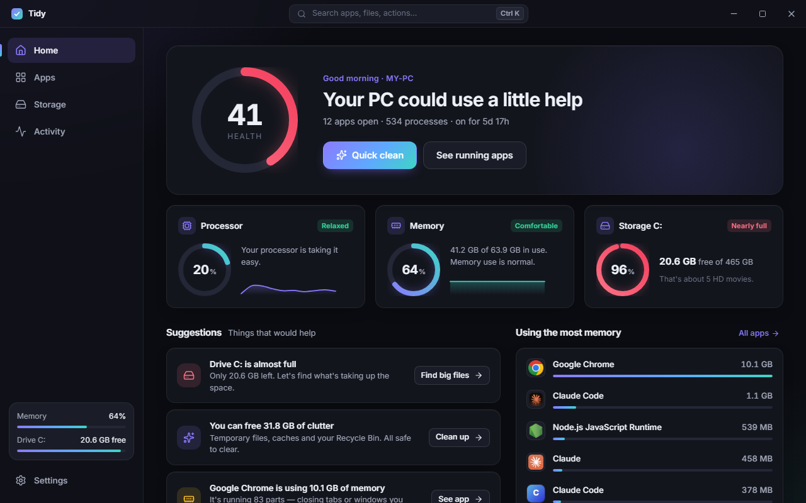
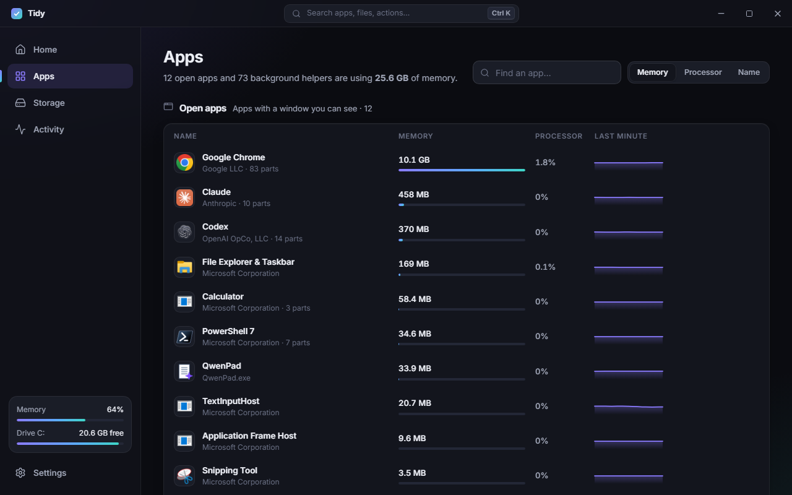
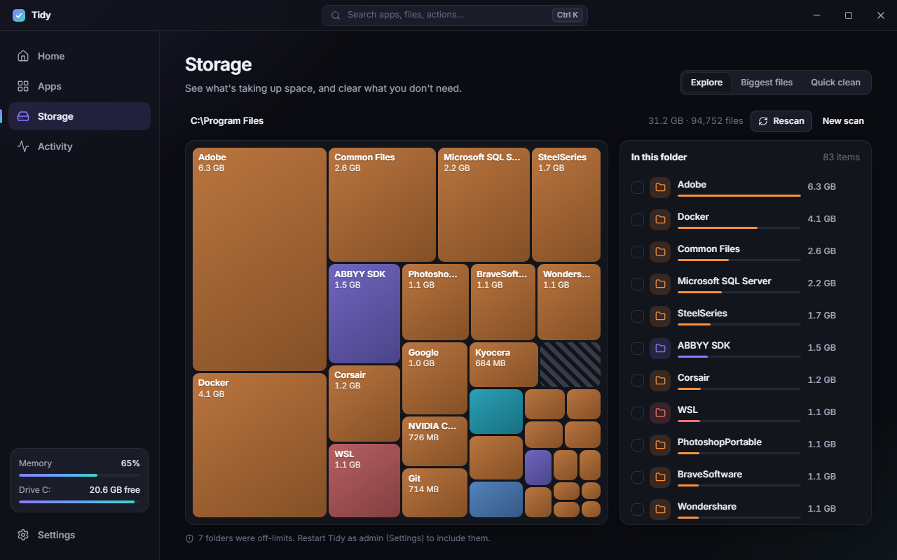
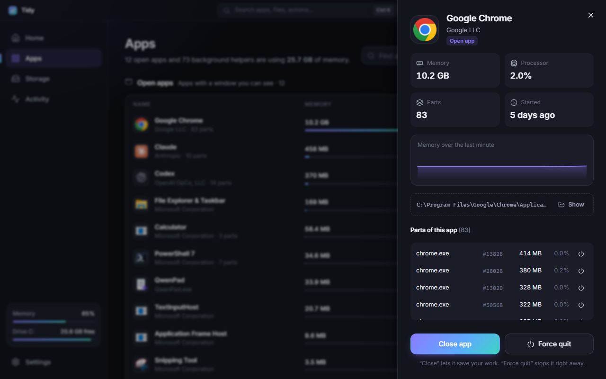
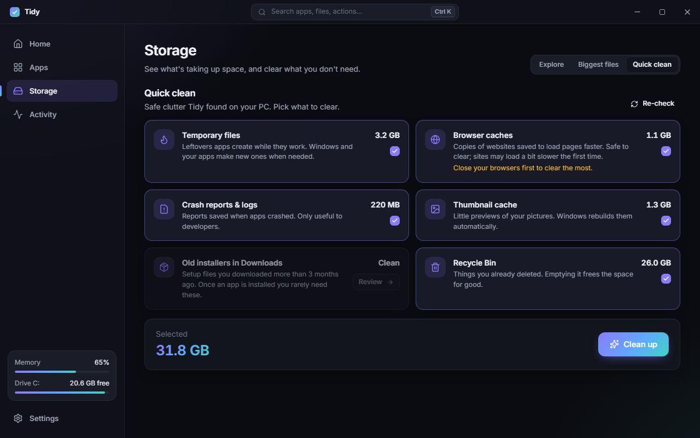
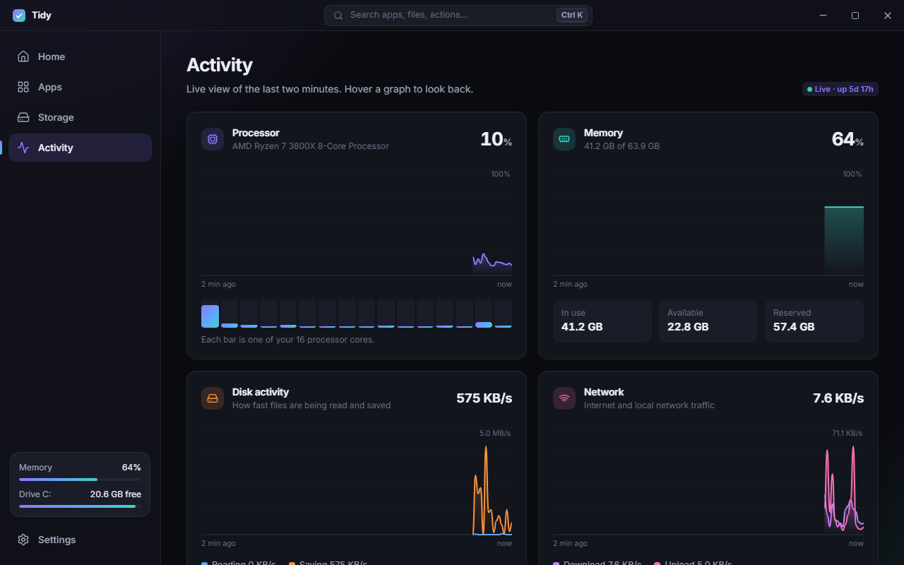
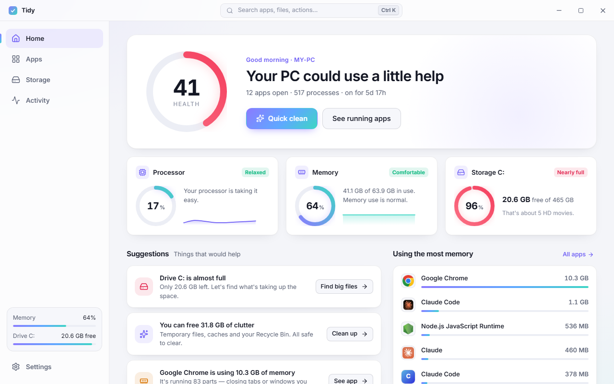

<div align="center">


# Tidy

**A free, beautiful Windows PC cleaner and system monitor that a beginner can understand.**
See which apps are eating your memory and CPU, find the files filling your drive, and clean up safely, from your PC or your phone.

No ads · No telemetry · No account · No installer · Open source

[](https://github.com/248Tech/Tidy/releases/latest/download/Tidy.exe)
[](https://248tech.github.io/Tidy/)
[-5fa8ff?style=for-the-badge)](https://github.com/248Tech/Tidy-Lite)

[](https://github.com/248Tech/Tidy/releases/latest)
[](https://github.com/248Tech/Tidy/releases)
[](https://github.com/248Tech/Tidy/actions/workflows/ci.yml)
[](LICENSE)
[](https://github.com/248Tech/Tidy/stargazers)
[](https://github.com/248Tech/Tidy/commits/main)


[**Download**](https://github.com/248Tech/Tidy/releases/latest) · [**Website**](https://248tech.github.io/Tidy/) · [Install guide](#install) · [Tidy Lite](https://github.com/248Tech/Tidy-Lite) · [Report a bug](https://github.com/248Tech/Tidy/issues)



</div>

## What is Tidy?

**Keywords:** Windows PC cleaner, disk space analyzer, free up disk space, what is using my RAM, task manager alternative, kill process, end task, large file finder, treemap, storage cleaner, temp file cleaner, system monitor, remote PC monitor, open source, portable, no telemetry.

Task Manager and Disk Cleanup work, but they're built for people who already know what `svchost.exe` is. Tidy explains your PC in plain English:

- **"Google Chrome is using 9.2 GB of memory."** It's running 82 parts. Closing tabs you don't need helps.
- **"Drive C: is almost full."** Here's what's taking the space, as a map you can click into.
- **"You can free 31.7 GB of clutter."** Temp files, browser caches, crash reports and the Recycle Bin, all safe to clear.

Everything you remove goes to the **Recycle Bin with an Undo button**, and Tidy won't let you stop or delete the parts of Windows that keep your PC running.

## Features

| | |
|---|---|
| 🩺 **Home** | A PC health score, gauges for processor, memory and storage with plain-English captions, and suggestions you can act on in one click. |
| 🧩 **Apps** | Running programs grouped into apps with their real icons. 80 `chrome.exe` processes show as one "Google Chrome" row. Live memory and CPU, a one-minute trend, **Close** (polite) or **Force quit**. |
| 🗺️ **Storage** | Scan any drive or folder. You get a zoomable **treemap** colored by what fills each folder (videos, games, AI models, installers…), a **biggest files** list, and multi-select delete. |
| ✨ **Quick clean** | Temporary files, browser caches (Chrome, Edge, Brave, Vivaldi, Firefox), crash dumps, the thumbnail cache, old installers in Downloads, and the Recycle Bin. |
| 📈 **Activity** | Live two-minute graphs: CPU and each core, memory, disk read/write, network up/down. |
| 📱 **Remote access** | Open the same UI on your phone or another PC. It's HTTPS with a 6-digit pairing code, and can be set to view-only. It also works over Tailscale or other VPNs. |
| 🛡️ **Safety rails** | Critical Windows processes can't be stopped. System folders can't be deleted. Risky actions explain what will happen first. Every action is logged. |
| 🎨 **Polish** | Light and dark themes, a `Ctrl+K` command palette, keyboard shortcuts, and a layout that also works on phones. |

<table>
<tr>
<td></td>
<td></td>
</tr>
<tr>
<td></td>
<td></td>
</tr>
<tr>
<td></td>
<td></td>
</tr>
</table>

## Install

Tidy is a single portable `.exe`. There's nothing to install and it doesn't need admin rights.

1. **Download** [`Tidy.exe`](https://github.com/248Tech/Tidy/releases/latest/download/Tidy.exe) from the [latest release](https://github.com/248Tech/Tidy/releases/latest). There's also a `.zip` with the README and license.
2. **Put it somewhere permanent**, for example `C:\Users\<you>\AppData\Local\Programs\Tidy\Tidy.exe`, or just your Desktop.
3. **Double-click it.** The first time, Windows SmartScreen may say *"Windows protected your PC"* because the app isn't code-signed yet. Click **More info → Run anyway**.

**Optional: add a Start menu shortcut** (PowerShell, run from the folder that contains `Tidy.exe`):

```powershell
$s = (New-Object -ComObject WScript.Shell).CreateShortcut("$env:APPDATA\Microsoft\Windows\Start Menu\Programs\Tidy.lnk")
$s.TargetPath = (Resolve-Path .\Tidy.exe).Path; $s.Save()
```

**Verify the download (optional):** compare against `SHA256SUMS.txt` on the release page.

```powershell
Get-FileHash .\Tidy.exe -Algorithm SHA256
```

**Requirements:** Windows 10 or 11 (64-bit) and the Microsoft Edge **WebView2** runtime. WebView2 is already installed on Windows 11 and on up-to-date Windows 10. If it's missing, Tidy offers to download it.

**Uninstall:** delete `Tidy.exe` and the `%APPDATA%\Tidy` folder (settings, remote-access certificate, audit log).

> 🪶 **Old or low-memory PC?** [**Tidy Lite**](https://github.com/248Tech/Tidy-Lite) is a 111 KB native version with no web engine at all. It covers the same essentials (apps, storage, clean up) without remote access.

## Remote access (phone / another PC)

Remote access is **off by default**. To use it:

1. In Tidy go to **Settings → Remote access** and turn it on.
2. On your phone, **scan the QR code**, or open the `https://<your-pc-ip>:7878` address shown.
3. Your browser warns about the certificate once. That's expected, because Tidy makes its own. Tap **Advanced → Continue**.
4. Type the **6-digit pairing code** shown on the PC.

Prefer a PC with no window? Run Tidy as a remote-only server:

```
Tidy.exe --serve                       # prints the URL and pairing code
Tidy.exe --serve --port 7979 --pin 123456
```

**How it's secured:** TLS with a self-signed certificate, a pairing-code login with an HttpOnly + SameSite=Strict session cookie, rate-limited code attempts (5 per IP per 5 minutes), and CSRF protection on every change. **View only** mode blocks closing apps and deleting files. Remote devices can never see the pairing code or change remote settings. Outside your home network, use a VPN such as Tailscale. Don't port-forward.

## Privacy & safety

- **No telemetry, no analytics, no update checks.** Tidy makes no network requests of its own. The remote-access server only runs if you turn it on.
- **Deletes go to the Recycle Bin** with Undo. Items too big for the Recycle Bin are refused rather than silently deleted forever, and permanent delete needs Shift plus a second confirmation.
- **Protected:** System, csrss, lsass, winlogon, services and other critical processes, plus `C:\Windows`, `Program Files`, `ProgramData`, `Users`, your profile folder, `pagefile.sys` and `hiberfil.sys`.
- **Audit log:** every close, force quit, delete, restore and clean-up is written to `%APPDATA%\Tidy\audit.log`.

## FAQ

**Is Tidy safe to use?** Yes. It only removes what you choose, deleted files go to the Recycle Bin, and it refuses to touch critical Windows files and processes. The source is open for anyone to read.

**Why does Windows warn me when I run it?** The exe isn't code-signed yet, so SmartScreen doesn't recognise it. Click **More info → Run anyway**, or check the SHA-256 hash against the release.

**How much memory does Tidy use?** Tidy itself uses about 75 MB. Its interface runs in Windows' built-in WebView2 engine, which adds more on top. If that matters to you, use [Tidy Lite](https://github.com/248Tech/Tidy-Lite), which uses about 45 MB in total.

**Does it run in the background?** No. There's no service and no tray icon, and it does no work when the window is closed.

## Build from source

Requirements: Go 1.22+, Node 20+, and the Wails CLI (`go install github.com/wailsapp/wails/v2/cmd/wails@latest`).

```bash
git clone https://github.com/248Tech/Tidy && cd Tidy
wails build -clean -trimpath -ldflags "-s -w"   # → build/bin/Tidy.exe
go test ./internal/...                          # scanner, protections, Recycle Bin round trip, icons, remote auth
wails dev                                       # desktop app with hot reload
go run ./cmd/devserve                           # UI + API in a normal browser at http://127.0.0.1:5199 (localhost only)
```

```
main.go             flags; desktop window (Wails) or --serve
internal/core/      metrics, processes, kill, icons, disk scanner, cleanup, Recycle Bin, protections, settings
internal/server/    HTTP API shared by the window and remote browsers, HTTPS remote server, pairing/auth
frontend/src/       Svelte 5 UI: routes/ (Home, Apps, Storage, Activity, Settings), components/, lib/
site/               the GitHub Pages website
```

The desktop window and remote browsers use the same `/api/*` handler. Wails serves it in-process, and remote mode puts pairing authentication in front of it.

## License

[MIT](LICENSE) © 2026 Joe Wayne / [248Tech LLC](https://248tech.github.io). Made by [248Tech](https://github.com/248Tech). See more projects at **[248tech.github.io](https://248tech.github.io)**.
